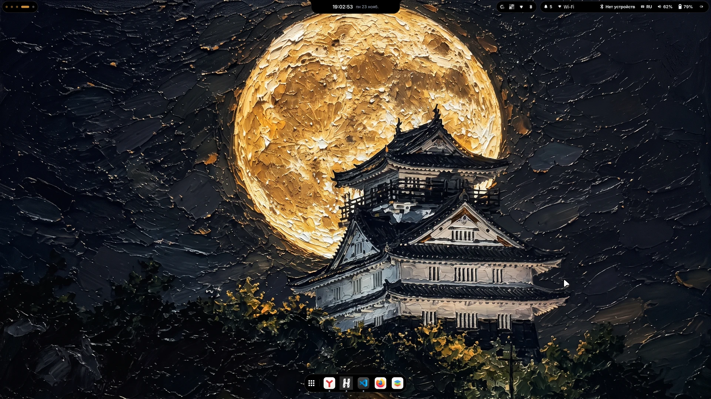
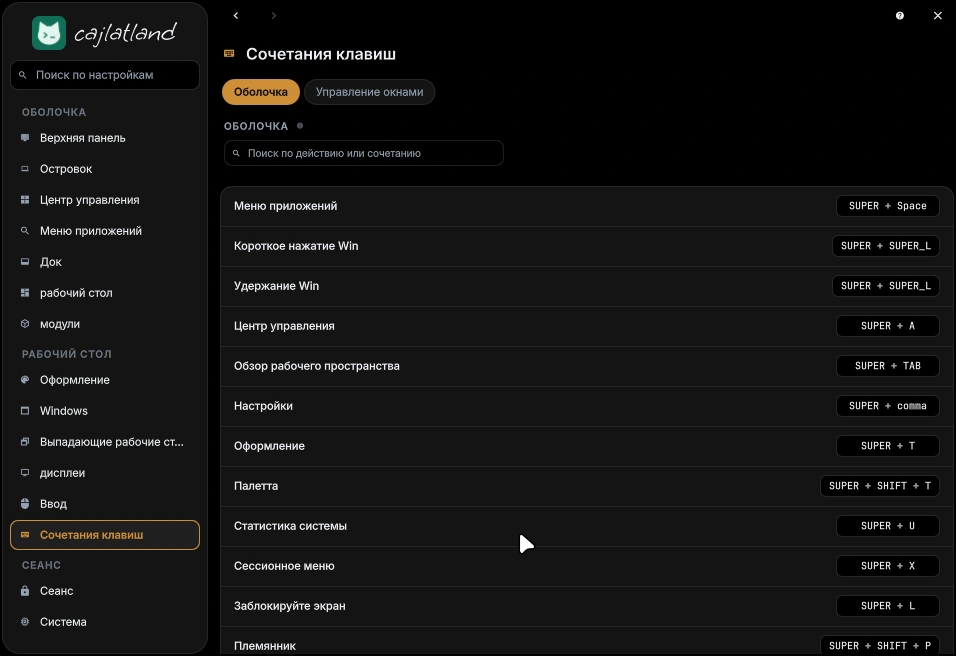

<p align="center"></p>

<h1 align="center">cajlatland</h1>
<p align="center">A bilingual (Russian &amp; English) desktop environment for Arch Linux powered by Hyprland and Quickshell.</p>
<p align="center"><a href="#install">Install</a> · <a href="#switcher">Cajlatland Switcher</a> · <a href="#desktop">Desktop</a> · <a href="#keys">Shortcuts</a> · <a href="https://github.com/cajlat1kkk/cajlatland/releases/latest">Latest Release</a></p>



<h2 id="install">Install from Terminal</h2>

The current `main` branch includes **Cajlatland Switcher**, a local service for smart Russian/English keyboard layout switching and typo correction. On Arch Linux with Git, an up-to-date Hyprland build with Lua support, and `sudo` access, run:

```bash
git clone https://github.com/cajlat1kkk/cajlatland.git && cd cajlatland && ./install.sh
```

Download the [ready-to-run installer](https://github.com/cajlat1kkk/cajlatland/releases/latest/download/cajlatland.run) and run `bash ./cajlatland.run`, or use the source installation above.

The installer updates packages via `pacman`, fetches dependencies, and deploys the configuration. Enter your password when `sudo` prompts for it, then log out and select **Hyprland** at the login screen. On first login, you may be prompted to build the compositor plugins.

The standard install includes **Firefox**, **Telegram Desktop**, **btop**, and **ONLYOFFICE Desktop Editors**. ONLYOFFICE is installed for your user from Flathub when it is missing. The installer also sets up NetworkManager for Wi-Fi, BlueZ for Bluetooth, and CUPS with Avahi for printing. An existing network manager is preserved.

<details>
<summary>Archive verification and backups</summary>

Run `bash ./cajlatland.run --check` to verify the integrity of a downloaded installer bundle without installing it. The bundle extracts into `~/.local/share/cajlatland-installer/`. During initial installation, any replaced config files are backed up to `~/.local/state/cajlatland/backups/`.

</details>

## Install and Build from Source

After cloning, you can customize the configuration before installing:

| What to customize | Location |
| --- | --- |
| Windows, keybindings, and autostart | [home/.config/hypr](home/.config/hypr) |
| Top bar, dock, and settings window | [home/.config/quickshell](home/.config/quickshell) |
| Default appearance and shell preferences | [default-settings.json](home/.local/share/cajlatland/default-settings.json) |
| Nautilus liquid theme and 7-Zip actions | [Nautilus extension](home/.local/share/nautilus-python/extensions) |
| System configs, login screen, and boot splash | [system](system) |
| Package dependencies | [packages](packages) |

Validate your edits with `./setup check`, then install from this directory with `./install.sh`. To package a standalone installer bundle for another machine, run `./packaging/build.sh` — the resulting file is written to `dist/cajlatland.run` and can be verified with `bash dist/cajlatland.run --check`.

<h2 id="switcher">Cajlatland Switcher</h2>

Switcher automatically fixes wrong-layout typing and typos in compatible Wayland text fields — for example, typing `ghbdtn` followed by Space turns into **привет**. All processing runs locally on your machine, and closing its settings window keeps the background service active.

| Gesture | Action |
| --- | --- |
| Tap `Shift` | Switch keyboard layout |
| Double-tap `Shift` | Convert the selection or last typed word |
| Press Left + Right `Shift` together | Pause or resume automatic layout correction |
| Hold `Shift` | Type an uppercase letter or shortcut as usual |

Press **Super → Cajlatland Switcher → Test Input** to try it out. Under **Settings → Excluded Apps**, you can review active exclusions (including Visual Studio Code) or toggle correction per application from installed entries and open window classes. Terminals and password managers are protected separately, and correction is disabled in password fields. Background correction works across compatible Wayland and IBus text fields; for Yandex Browser, the installer configures GTK/IBus support under XWayland (restart the browser completely from the launcher to apply).

[Switcher source code, MIT license, and documentation](home/.local/share/cajlatland-switcher)

<h2 id="desktop">Desktop</h2>

- **Top Bar & Dynamic Island** display workspaces, clock, keyboard layout, audio volume, and battery status. Click the central island to open the Control Centre.
- **Bottom Dock** appears on empty workspaces and auto-hides when windows are open. Move the pointer to the bottom-center edge bar to reveal it.
- **Language & Date Settings** let you switch the shell interface language (English, Russian, Spanish), configure system locale, timezone, NTP synchronization, manual date/time, and clock format directly from **cajlatland Settings → Language & Date**.
- **Kitty Terminal** comes preconfigured with Zsh, and both the terminal and file manager use a dark translucent theme.
- **Nautilus** opens with **Win + E** and uses a dark, translucent background with blur. Right-click a file or folder and choose **7-Zip → Сжать в .7z** or **Сжать в .zip** to create the archive in the same directory.
  Under **Appearance → File manager**, you can change the background style, opacity and sidebar shading. Right-click empty space in Nautilus and choose **Appearance settings…** to open the same page.

<h2 id="keys">Keyboard Shortcuts</h2>

| Action | Default shortcut |
| --- | --- |
| Open application launcher | Tap **Super** |
| Open terminal | **Super + Enter** |
| Open file manager | **Super + E** |
| Switch keyboard layout | **Alt + Shift** |
| Move window to workspace | **Super + Shift + Number** |
| Resize window width or height | **Super + Alt + Arrow** |
| Lock screen | **Super + L** |

To customize any binding, press **Super**, open **cajlatland Settings**, and go to **Keys**. Select an action, click its current shortcut, press the new key combination, and click **Apply**.



## About

cajlatland is an open-source Hyprland desktop configuration maintained by **cajlat1kk**, bringing together [M4OS](https://github.com/mylinuxforwork/dotfiles) and [Impasto](https://github.com/andreumassanet/impasto). Licensed under GPL-3.0.

[GitHub](https://github.com/cajlat1kkk) · [VK](https://vk.ru/ilyshalaev) · [Telegram](https://t.me/IlyShalaev)

[Install Cajlatland Switcher separately](https://github.com/cajlat1kkk/cajlatland-switcher).
